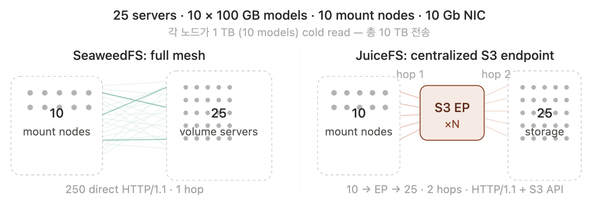
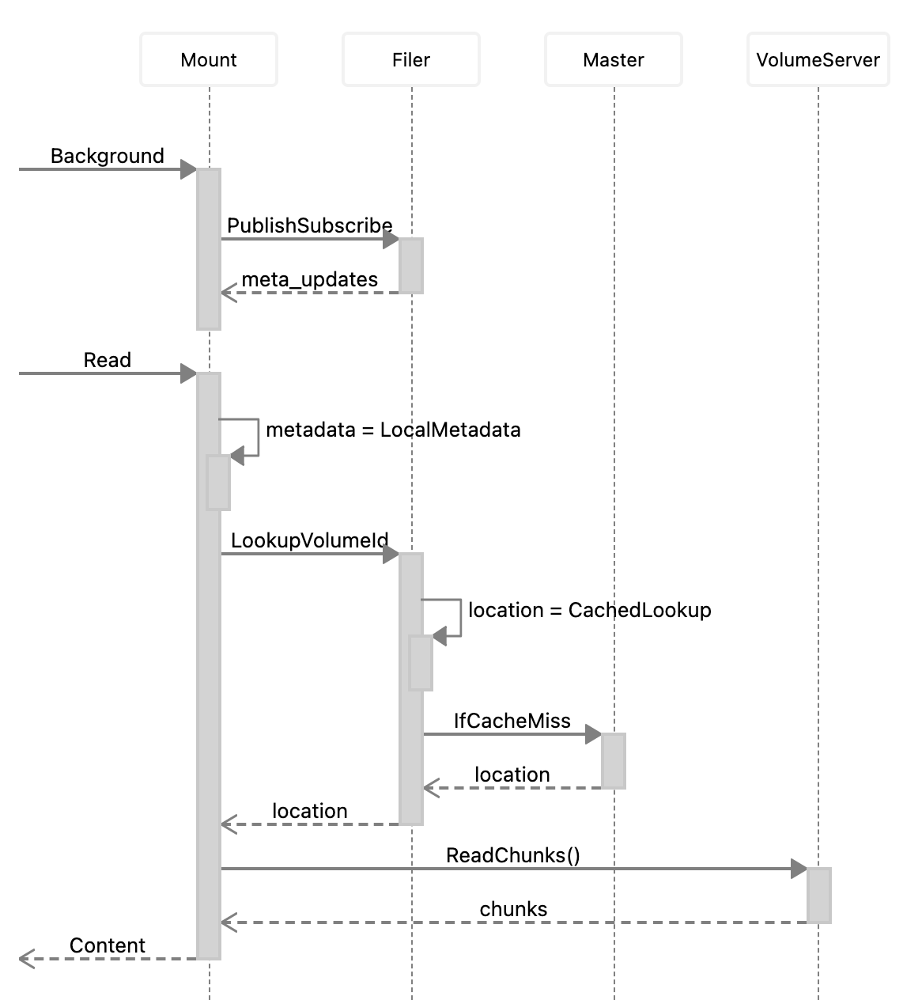

# Distributing AI Model Files for Multi-GPU Loading

Serving a large language model across a fleet of GPU hosts is a read fan-out problem. Every `weed mount` client needs the same multi-gigabyte weights file at roughly the same time, and the cluster delivers the model only as fast as the fan-out stage lets it. This page covers the architectural reason SeaweedFS is well-suited to the workload, the subtle placement problem that keeps it from reaching full potential by default, and how the `fs.distributeChunks` shell command introduced in [PR #9117](https://github.com/seaweedfs/seaweedfs/pull/9117) fixes it.

## The use case

Deploy large LLM models across hundreds of GPU servers using `weed mount`. A key architectural advantage of SeaweedFS in this scenario is its **full-mesh connectivity**: each `weed mount` client can directly connect to and receive chunks from all volume servers simultaneously, without routing through an intermediate proxy or gateway node. This is a significant advantage over S3-based distributed file systems, where reads are funneled through a relay layer.



To fully leverage this architecture, when multiple `weed mount` clients concurrently read the same large model file (e.g., during model loading across hundreds of GPU servers), the reads must be able to **fan out across all volume server nodes**. This requires the file's chunks to be distributed evenly across all nodes.

However, when writing large files via `weed mount`, the master server selects volumes using a random pick (`rand.IntN(len(writables))`) among writable volumes. In practice, this can result in chunks for a single file being concentrated on only a few nodes — leaving the full-mesh read throughput largely unrealized.

The `weed mount` read path for reference:



Every arrow in the picture is a direct client-to-volume-server connection. If the chunks of a single file live on only 3 of 30 volume servers, only 3 of those arrows are ever used when the file is read, regardless of how many GPU hosts are mounting the same filer.

## Real-world deployment context

The PR author shared concrete numbers from their production LLM serving setup, which is a useful reference for sizing and tuning decisions.

### Model and shard sizes

Model sizes and individual weight-file sizes vary significantly. Representative examples:

| Model | Total size | Per-shard size |
|-------|-----------|----------------|
| GLM-5.1 | ~1.5 TB | ~5 GB |
| Qwen3.5-397B-A17B | ~807 GB | ~8 GB |
| Qwen3.5-0.8B | ~1.77 GB | (single shard) |

Each shard is a single file that the GPU fleet reads. At 5-8 GB per shard and 16 MB per chunk (see below), a single shard produces roughly 300-500 chunks — plenty to spread across a 25-node cluster.

### Cluster topology

- Initial setup: a single cluster of **50 volume servers**. The operator occasionally saw chunk loss and found live updates of SeaweedFS operationally burdensome at that size.
- Current setup: **two clusters of 25 volume servers each**, configured active-passive using [`filer.sync`](https://github.com/seaweedfs/seaweedfs/wiki/Filer-Active-Active-cross-cluster-continuous-synchronization). Smaller per-cluster footprint, easier rolling upgrades, and a clean failover target.
- Storage: **HDD-based** volume servers. No NVMe.
- Network: **10 GbE** between nodes. No InfiniBand, no RDMA — these were out of reach due to infrastructure constraints.

The choice of SeaweedFS was driven specifically by the full-mesh data-access pattern: when the underlying NIC is a modest 10 GbE and the disks are spinning, the only way to get competitive aggregate read throughput to hundreds of GPU hosts is to add volume servers to the cluster and have every client pull from every server in parallel. S3-style architectures that funnel reads through a gateway layer cannot do this — which is the whole point of the use case.

### Chunk size

The operator currently uses **16 MB chunk size**. The tradeoff observed in practice:

- Smaller chunks perform better for cold reads — more parallelism, smaller tail-latency units.
- Too small, and the chunk count explodes, putting pressure on the filer's metadata database.
- 16 MB is the current operational sweet spot for this workload.

(Note: the operator flagged a separate issue they intend to file about creating 100 GB files with `chunksize=8MB` — relevant if you want to go smaller.)

### How `fs.distributeChunks` fits in

Against this backdrop, the value of `fs.distributeChunks` is concrete. On a 25-node HDD+10GbE cluster, a 5 GB model shard written via `weed mount` can easily concentrate its ~300 chunks on 5-10 nodes by random luck. Running `fs.distributeChunks -mode=round-robin` after each model upload expands that to all 25 nodes, so the next model-loading event pulls bytes from 25 NICs in parallel instead of 5-10.

## How `fs.distributeChunks` solves it

`fs.distributeChunks` redistributes a file's chunks evenly across volume server nodes by copying each chunk to a target node, updating the filer metadata atomically, and deleting the old copies. It supports three modes for different balancing goals, all selectable via `-mode`.

### Distribution modes

#### `primary` (default)

Balances chunk count per node using topology-based ownership mapping. For each chunk's volume, the owning node is determined as `volume_nodes[vid % len(volume_nodes)]` where `volume_nodes` is the sorted list of nodes holding that volume (= replication copy count). Chunks are moved from nodes exceeding the ideal count (`totalChunks / totalNodes`) to nodes below it.

**Limitation**: With replication, the computed owner may not match the actual `Assign` target node, since new volumes receive IDs that may hash to a different node. Results are approximate in replicated environments.

#### `replica`

Performs primary-mode balancing (Step 1), then additionally moves chunks to balance the total copies-per-node count including replicas (Step 2). The copies target is `totalCopies / totalNodes`.

**Limitation**: The replica placement of each new volume is determined by the master at volume grow time based on replication policy — it cannot be specified externally. Therefore perfect convergence is not guaranteed in a single pass; multiple runs converge progressively.

#### `round-robin`

Sorts chunks by file offset and assigns them to nodes in round-robin order: `chunk[i] -> nodeList[i % N]`. This ensures consecutive chunks are placed on different nodes, enabling I/O pipelining during sequential reads — exactly the pattern a GPU host executes when loading a model file start-to-finish into HBM.

This mode does not depend on ownership calculation. The `Assign(DataNode=X)` call places the primary on the intended node regardless of how the ownership mapping resolves afterward.

**Note**: As with all modes, replica placement is controlled by the master at volume grow time and cannot be specified externally. The read-path may use any replica, so the exact A->B->C pipeline pattern depends on client behavior.

## End-to-end workflow

A model is written once and read by many. Run redistribution right after the write, before the GPU fleet starts pulling it:

```bash
# 1. Upload the model once via weed mount (or S3, or filer API)
cp llama-70b.safetensors /mnt/seaweedfs/models/llama-70b/

# 2. Dry-run: see the proposed plan without touching data
echo "fs.distributeChunks -path=/models/llama-70b/weights.safetensors -mode=round-robin" \
  | weed shell

# 3. Apply the redistribution
echo "fs.distributeChunks -path=/models/llama-70b/weights.safetensors -mode=round-robin -apply" \
  | weed shell

# 4. GPU hosts mount and load as usual — no client-side change needed
weed mount -filer=filer:8888 -dir=/mnt/seaweedfs
# training / inference framework reads /mnt/seaweedfs/models/llama-70b/weights.safetensors
```

### CLI flags

| Flag | Default | Meaning |
|------|---------|---------|
| `-path` | (required) | File path to redistribute chunks for. Must be a regular file, not a directory. |
| `-mode` | `primary` | One of `primary`, `replica`, `round-robin`. |
| `-nodes` | `0` (all nodes) | Target a specific number of nodes; useful to keep the fan-out inside a rack or AZ, or to avoid spraying small files across every server. |
| `-apply` | `false` | Without this flag the command is a dry run that prints the plan. With it, the moves execute. |

### Example commands (from the command's own help text)

```
# analyze current distribution (dry-run, primary mode)
fs.distributeChunks -path=/buckets/my-bucket/large-file.dat

# apply redistribution
fs.distributeChunks -path=/buckets/my-bucket/large-file.dat -apply

# distribute across 5 nodes (instead of all)
fs.distributeChunks -path=/buckets/my-bucket/large-file.dat -nodes=5 -apply

# balance including replica copies
fs.distributeChunks -path=/buckets/my-bucket/large-file.dat -mode=replica -apply

# round-robin for sequential read performance (recommended with replication)
fs.distributeChunks -path=/buckets/my-bucket/large-file.dat -mode=round-robin -apply
```

## Implementation

Each redistribution operation per chunk follows this sequence:

1. **Download**: `HTTP GET http://{source_volume_server}/{old_fid}`
2. **Assign**: `gRPC Assign(DataNode={target_node})` to get a new FID on the target node
3. **Upload**: `HTTP PUT http://{target_volume_server}/{new_fid}`
4. **Update metadata**: `gRPC filer_pb.UpdateEntry` with the updated chunk FID list
5. **Delete original**: `HTTP DELETE http://{source_volume_server}/{old_fid}`
   - Only sent to one volume server; `ReplicatedDelete` propagates to all replicas automatically

The delete is sent to a single volume server because `ReplicatedDelete` in `topology/store_replicate.go` calls `LookupVolumeId` to find all replica locations and propagates the deletion to each one. Sending DELETE to all replicas individually would cause 404 errors on the replicas that have already been deleted by propagation.

Filer metadata is updated via gRPC `UpdateEntry` after all chunk copies succeed. If the metadata update fails, the original chunks remain intact and the newly uploaded copies are orphaned (no data loss). Old chunks are deleted only after metadata update succeeds.

## Verification

Tested on a 3-node dev cluster (replication `001`, 2 copies per volume). md5 verified identical before and after on every run:

| File | Size | Mode | Chunks moved | md5 before | md5 after | Result |
|------|------|------|-------------|------------|-----------|--------|
| `cs8_1G` | 1 GB | `primary` | 14 | `379efd6f...` | `379efd6f...` | match |
| `cs8_1G` | 1 GB | `replica` | 8 | `379efd6f...` | `379efd6f...` | match |
| `cs8_1G` | 1 GB | `round-robin` | 86 | `379efd6f...` | `379efd6f...` | match |
| `test_10g.dat` | 10 GB | `round-robin` | 1703 | `3875bfd3...` | `3875bfd3...` | match |

## Chunk manifest handling

Files large enough to use chunk manifests (manifest-of-chunks indirection) are handled transparently. The command resolves the manifest down to the underlying data chunks, redistributes those leaf chunks, then re-manifests before updating the filer entry. The old manifest and data chunks are garbage-collected by the filer — no special flag needed from the operator.

## Limitations

- **Replica placement is not externally controllable.** All three modes can only specify the primary node via `Assign(DataNode=X)`. The replica node is determined by the master at volume grow time based on replication policy. Redistribution is best-effort for replica distribution.
- **`primary` and `replica` modes use approximate ownership.** The `vid % len(volume_nodes)` ownership mapping is a heuristic and may not reflect the actual `Assign` target, causing the post-redistribution view to appear imbalanced. If that happens, prefer `round-robin`, which sidesteps the heuristic entirely.

## When to use which mode

| Workload | Mode |
|----------|------|
| Many clients streaming the same large model sequentially (LLM weight loading on a GPU fleet) | `round-robin` |
| General chunk balancing on an unreplicated or lightly replicated cluster | `primary` |
| Want replicas to share read load too, not just primaries | `replica` |

## See also

- [FUSE Mount](./FUSE-Mount.md) — how `weed mount` is used on each GPU host
- [weed shell](./weed-shell.md) — the operator console where `fs.distributeChunks` runs
- [Replication](./Replication.md) — replica placement is controlled here
- [Large File Handling](./Large-File-Handling.md) — chunk and manifest structure background
- [TensorFlow with SeaweedFS](./TensorFlow-with-SeaweedFS.md) — S3-side ML integration
