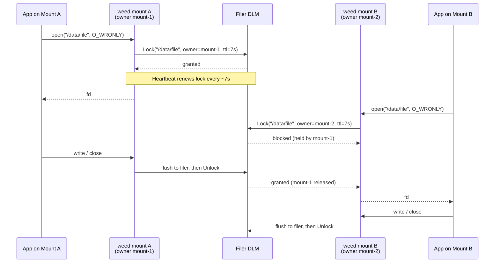
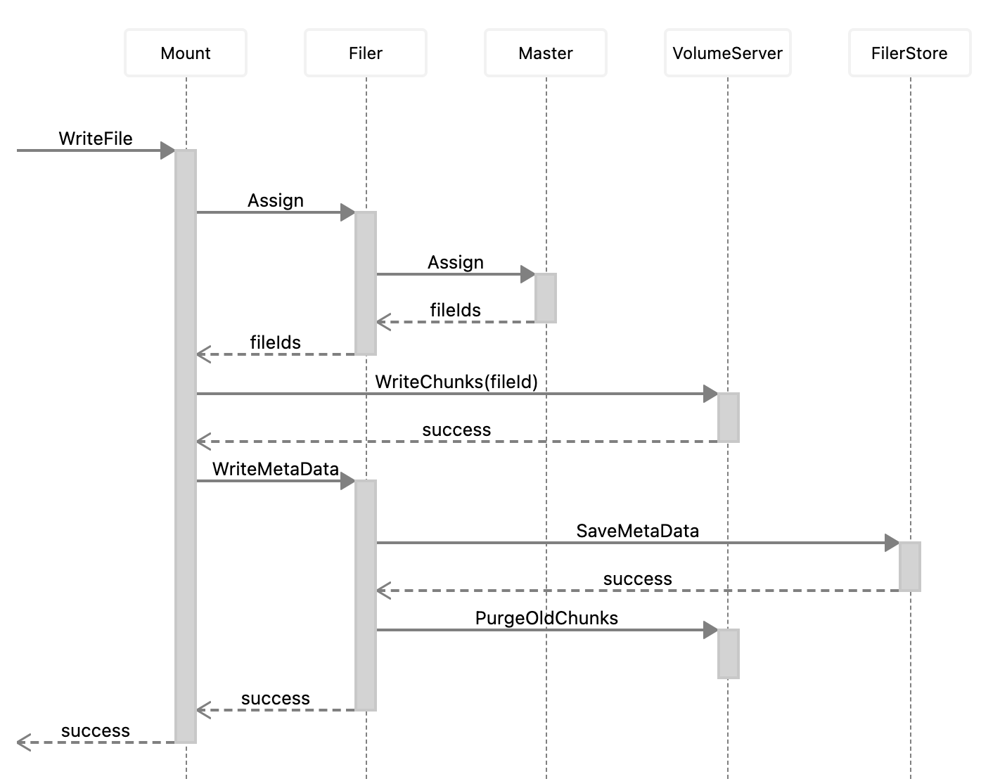

### Supported Features
With "weed mount", the files can be operated as a local file. The following operations are supported.
* file read / write
* create new file
* mkdir
* list
* remove
* rename
* chmod
* chown
* soft link
* hard link
* display free disk space
* copy file range
* lseek
* advisory file locking (`flock(2)` and POSIX `fcntl(2)` byte-range locks)
* extended attributes (xattr)

### Distributed Lock (cross-mount write coordination)

`weed mount` can coordinate writers across different mount instances using
the filer's distributed lock manager (DLM). When enabled, opening a file
for writing acquires a cluster-wide lock on the file's filer path, so only
one mount can write a given file at a time. Other mounts that open the same
file for writing block until the holder releases it.

#### Enabling

Pass `-dlm` when starting `weed mount`:

```bash
weed mount -filer=localhost:8888 -dir=/mnt/seaweedfs -dlm
```

DLM is off by default. It is automatically disabled if `-writebackCache` is
also set, since writeback implies single-writer semantics and the extra
coordination would only add latency. When DLM is disabled, writers across
mounts are unordered — last writer wins on flush.

#### Flow



If mount A crashes without closing, the filer drops the lock after the
7-second TTL and mount B's pending acquire unblocks automatically.

#### Semantics

* **Scope.** The lock key is the file's filer path (not the local inode,
  which is per-mount). Two mounts opening the same path for writing contend
  on the same key.
* **Acquisition.** The lock is taken when a handle is opened with any write
  flag (`O_WRONLY`, `O_RDWR`, `O_APPEND`, `O_CREAT`, `O_TRUNC`). Read-only
  opens are not locked. Acquisition is blocking: a second mount's
  `open(2)`-for-write blocks until the first mount closes the file or the
  lock TTL expires.
* **Release.** The lock is held for the full lifetime of the file handle
  and released on close. For handles running the writeback async flush
  path, the lock is released after the background flush completes — so a
  reader on another mount after a successful close always sees the flushed
  data.
* **Auto-renewal.** The lock is renewed on a 7-second TTL heartbeat while
  the handle is open. If a mount crashes, the lock frees on TTL expiry.
* **Rename and unlink.** `rename(2)` acquires DLM locks on both the source
  and destination paths (sorted to avoid A→B / B→A deadlocks) so no other
  mount can open either path for writing during the rename. `unlink(2)` of
  a file that is currently open on this mount coordinates with the held
  handle's lock.
* **Owner identifier.** Each mount is tagged with `mount-&lt;signature&gt;`,
  which appears in filer lock logs and in `weed shell`'s lock commands for
  debugging.

#### Requirements and constraints

* At least one filer address (`-filer=`) must be configured; DLM is a
  filer-hosted service.
* DLM is disabled when `-writebackCache` is set (single-writer mode).
* DLM coordinates writes only. Concurrent readers on different mounts are
  never blocked, and they still see flushed data via the filer's metadata.
* DLM does not replace POSIX `fcntl`/`flock` advisory locks; those remain
  available and are orthogonal (see the next section).

#### When to use it

Enable `-dlm` when multiple `weed mount` instances may write to the same
files — e.g. a shared build cache mounted on several CI workers, or an
application that runs on multiple nodes and writes to the same path. Leave
it off for single-mount deployments or when each mount writes into its own
subtree, since the extra round-trips add latency on every open-for-write.

### Advisory File Locking

SeaweedFS supports advisory file locking over FUSE:

* whole-file locks via `flock(2)`
* POSIX byte-range locks via `fcntl(2)` (`F_SETLK`, `F_SETLKW`, `F_GETLK`)

The locks follow normal close semantics:

* POSIX `fcntl` locks are released when the closing lock owner closes the file
* `flock` locks are released with the file description close path

These are advisory locks, so applications must cooperate by taking and honoring them.

### Extended Attributes (xattr)

SeaweedFS supports POSIX extended attributes on files and directories via FUSE mount. You can use standard tools like `setfattr`, `getfattr`, and `xattr` to manage custom metadata.

#### Examples

```bash
# Set a custom attribute
setfattr -n user.expire -v "2025-12-01" /mnt/seaweedfs/path/to/file

# Get a custom attribute
getfattr -n user.expire /mnt/seaweedfs/path/to/file

# List all extended attributes
getfattr -d /mnt/seaweedfs/path/to/file

# Remove an extended attribute
setfattr -x user.expire /mnt/seaweedfs/path/to/file

# On macOS, use xattr instead
xattr -w user.expire "2025-12-01" /mnt/seaweedfs/path/to/file
xattr -p user.expire /mnt/seaweedfs/path/to/file
xattr -l /mnt/seaweedfs/path/to/file
xattr -d user.expire /mnt/seaweedfs/path/to/file
```

#### Limits

| Limit | Value |
| ----- | ----- |
| Max attribute name size | 255 bytes |
| Max attribute value size | 64 KB (65536 bytes) |

#### Disabling xattr

If you don't need extended attributes, you can disable them with the `-disableXAttr` flag:

```bash
weed mount -filer=localhost:8888 -dir=/mnt/seaweedfs -disableXAttr
```

### Mount as FUSE

This uses seaweedfs/fuse, which enables writing FUSE file systems on Linux and OS X. On OS X, it requires OSXFUSE (https://osxfuse.github.io/).

```bash
# assuming you already started weed master, weed volume and filer
weed mount -filer=localhost:8888 -dir=/some/existing/dir -filer.path=/one/remote/folder
weed mount -filer=localhost:8888 -dir=/some/existing/dir -filer.path=/
# example: mount one collection and a folder to a local directory
weed mount -filer=localhost:8888 -dir=~/folder_on_seaweedfs -filer.path=/home/chris -collection=chris
```

It is also possible use mount and fuse subtype:

```bash
cp weed /sbin/weed
mount -t fuse.weed fuse /mnt -o "filer=localhost:8888,filer.path=/"
```

Or add weed as a mount subtype:

```bash
cp weed /sbin/mount.weed
mount -t weed fuse /mnt -o "filer=localhost:8888,filer.path=/"
```

To mount with multiple filers enclose filer parameter with quotes and separate servers with comma:

```bash
cp weed /sbin/mount.weed
mount -t weed fuse /mnt -o "filer='192.168.0.1:8888,192.168.0.2:8888',filer.path=/"
```

Now you can operate the SeaweedFS files, browsing or modifying directories and files, in local file system. 
To unmount, just shut it down the "weed mount".

#### Disk name (`-volumeName`)

Where the platform labels the mount — Finder on macOS, Explorer on Windows, and `mount`/`df` on Linux and FreeBSD — the name is derived from the mounted path: `-filer.path` first, then the `-dir` mount point, then the filer address. `-volumeName` overrides that derivation without changing what is mounted:

```bash
weed mount -filer=localhost:8888 -dir=/mnt/seaweedfs -filer.path=/ -volumeName=Photos
```

Leave `-volumeName` empty to keep the derived name. On Windows the override is the volume label Explorer shows; the UNC share name (e.g. `\\seaweedfs\Images`) is unaffected. See [Mount on Windows](./Mount-on-Windows.md) for the Windows-specific details.

#### Mount with fstab

```
weed#fuse /mnt fuse _netdev,filer='192.168.0.1:8888',filer.path=/ 0 0
```

#### Mount outside of a SeaweedFS cluster

In addition to connecting to filer server, `weed mount` also directly connects to volume servers directly for better performance. 
However, if the SeaweedFS cluster is started by Kubernetes or docker-compose and 
the volume servers only knows its own IP addresses inside the cluster, 
`weed mount` is not able to access the volume servers from outside of the cluster.

`weed mount -volumeServerAccess=[direct|publicUrl|filerProxy]` option can help here. You can choose to proxy the requests to volume servers via filer.
So only filer needs to be exposed. Or you can choose to expose the public URLs of volume servers.

#### Multiple mounts with multiple Filers of a SeaweedFS cluster

Updates from one filer are transferred to the other filers. The filers would not be constantly querying the 
filer stores for updates. Instead, the filers will listen to each other for updates, which is more efficient.

So for the following topology, the updates from one mount can be propagated to other mounts. 

```

mount1 ---> filer1 ---> filer2 ---> mount2
                |
                +-----> filer3 ---> mount3
```

However, in most cases, one filer should be enough, since the mount will only get asynchronous metadata updates to filer,
and will read and write to the volume servers directly, one filer should be enough to handle most of the work.

```

filer ---- mount1
   |
   +------ mount2
   |
   +------ mount3

```

#### Distributed Lock Manager (DLM) for Cross-Mount Write Coordination

When multiple mounts write to the same file concurrently, the default behavior is **last-flush-wins** — each mount builds its chunk list independently and flushes metadata to the filer. The second flush overwrites the first, silently orphaning the first mount's chunks.

The `-dlm` flag enables distributed lock coordination across mounts. When enabled:

* Opening a file for writing acquires a distributed lock (blocking until held)
* The lock is auto-renewed for the entire write session
* The lock is released when the file is closed (after flush completes)
* Only one mount can have a file open for writing at a time
* Read-only opens are not locked — readers never block

```bash
# Start two mounts with DLM enabled, each pointing to a different filer
weed mount -filer=filer1:8888 -dir=/mnt/seaweed1 -dlm
weed mount -filer=filer2:8888 -dir=/mnt/seaweed2 -dlm
```

**How it works:**

The DLM uses the filer's built-in distributed lock service (the same one used by the S3 API). The lock key is the file's inode number, so renames don't break mutual exclusion. The lock TTL is 7 seconds with renewal every 3.5 seconds — if a mount crashes, the lock expires and other mounts can proceed.

```
mount1 (write-open file) ---> filer1 ---> DLM lock acquired
mount2 (write-open same file) ---> filer2 ---> blocks until mount1 closes
```

**Requirements:**
* At least 2 filers in the same `-filerGroup` for the lock ring to function
* All mounts that write to shared files should use `-dlm`; mounts without `-dlm` bypass the lock entirely

**When to use:**
* Multiple mounts writing to overlapping files (shared data pipelines, collaborative workflows)
* When data integrity matters more than maximum write throughput

**When NOT to use:**
* Single mount or mounts writing to disjoint files — DLM adds unnecessary overhead
* Workloads where last-writer-wins is acceptable

#### Mount directory on host from docker-compose

If docker compose is being used to manage the server (eg. https://github.com/seaweedfs/seaweedfs/wiki/Getting-Started#with-compose) 
it's possible to mount a directory on the host with docker privileged mode like so:
```
  mount_1:
    image: chrislusf/seaweedfs
    cap_add:
      - SYS_ADMIN
    devices:
      - "/dev/fuse:/dev/fuse"
    volumes:
      - "/hostdata/mount:/mnt:z,shared"
    entrypoint: weed
    command: mount
    environment:
      - DIR=/mnt/data
      - DIRAUTOCREATE=true
      - FILER=localhost:8888,localhost:8889
    depends_on:
      - master
      - filer
```

### Weed Mount Architecture

`weed mount` has a persistent client connecting to Master, to get the location updates of all volumes.
There are no network round trip to lookup the volume id location.

`weed mount` also continuously synchronize all metadata updates with the Filer. So later reads would not need a network read from Filer, and the metadata reads, e.g., directory listings, are all local operations.

For reads:
1. Mount optionally lookups volume Id => Weed Filer => Weed Master
2. Mount Reads File Chunks => Weed Volume Servers


For writes:
1. Mount uploads data to Weed Volume Servers, and breaks the large files into chunks.
2. Mount writes the metadata and chunk information into Filer and then into Filer database.



### Bounding the write buffer (`-writeBufferSizeMB`)

While an application is writing, `weed mount` buffers each outstanding chunk in RAM (for sequential writes) or in a swap file on local disk — by default under `-cacheDir` (i.e. `os.TempDir()`, which is usually `/tmp` on Linux). Once a chunk is full it is handed to an uploader goroutine that pushes it to a volume server; the buffered chunk is only released when the upload has completed and no reader is still referring to it.

Normally these uploads drain fast enough that the buffer stays small. But if volume servers stall — for example every candidate volume is at the size limit and the master hasn't yet rotated assignments — the upload queue grows, sealed chunks pile up, and the swap file can grow until `/tmp` fills. A large `rclone` sync into such a cluster has been observed to fill a 1.8 TiB `/tmp` partition before the mount process is killed.

`-writeBufferSizeMB=N` (default `0` = unlimited, preserving the old behavior) installs a single byte budget that is shared across every open file handle on a mount. When the budget is reached, additional writes block inside the FUSE write path until an earlier upload completes and frees its slot — so swap overflow becomes natural back-pressure on the client instead of unbounded disk growth.

```bash
# Cap the total write buffer at 2 GiB, keep swap off /tmp.
weed mount \
  -filer=localhost:8888 -dir=/mnt/seaweedfs -filer.path=/ \
  -cacheDirWrite=/var/cache/seaweedfs \
  -writeBufferSizeMB=2048 \
  -chunkSizeLimitMB=32 \
  -concurrentWriters=128
```

Notes:
* The budget is counted in whole chunks of `-chunkSizeLimitMB`, not in arbitrary bytes, so the effective maximum is `floor(writeBufferSizeMB / chunkSizeLimitMB) * chunkSizeLimitMB`.
* Choose `writeBufferSizeMB` ≥ `chunkSizeLimitMB` — otherwise a single chunk would never fit. The accountant allows an oversized reservation only when the budget is empty, to keep a single writer from starving itself.
* The flag is independent of `-cacheCapacityMB`, which sizes the *read* chunk cache on disk.
* `-cacheDirWrite` (if unset, falls back to `-cacheDir`, which defaults to `os.TempDir()`) is where the swap file lives. When upload stalls are possible it is strongly recommended to point this at a dedicated disk — not `/tmp` — and to set `-writeBufferSizeMB` below the available space on that disk.
* The cap is a mount-global limit, not per-file. With many concurrently open writers it will serialize them rather than corrupt any of them.

### Tuning kernel FUSE concurrency (`-fuse.maxBackground`, `-fuse.congestionThreshold`)

The Linux kernel FUSE driver caps the number of asynchronous in-flight requests it will hand to a userspace filesystem at once. Two knobs control this, both exposed under `/sys/fs/fuse/connections/&lt;id&gt;/`:

* `max_background` — hard cap on background (asynchronous) requests in flight.
* `congestion_threshold` — when in-flight requests reach this value, the kernel marks the bdi as congested, throttling new submissions. Default is `3/4 * max_background`.

Default `max_background` in `weed mount` is **128**, which is fine for most workloads. Heavy parallel-upload workloads (large `rclone`/`rsync` syncs, ML dataset ingest, many writer processes) can saturate that queue and become latency-bound on the FUSE channel itself rather than on volume servers.

`-fuse.maxBackground=N` and `-fuse.congestionThreshold=N` let you set both at mount time, so the values persist across reboots without a startup script that writes to `/sys/fs/fuse/connections/&lt;id&gt;/...`:

```bash
weed mount \
  -filer=localhost:8888 -dir=/mnt/seaweedfs \
  -fuse.maxBackground=2048
```

With only `-fuse.maxBackground=2048`, the kernel sets `max_background=2048` and derives `congestion_threshold=1536` (3/4 of 2048) on the new FUSE connection — equivalent to:

```bash
echo 2048 | sudo tee /sys/fs/fuse/connections/<id>/max_background
echo 1536 | sudo tee /sys/fs/fuse/connections/<id>/congestion_threshold
```

If you want a non-3/4 ratio (for example, more headroom before congestion kicks in), set both:

```bash
weed mount \
  -filer=localhost:8888 -dir=/mnt/seaweedfs \
  -fuse.maxBackground=2048 \
  -fuse.congestionThreshold=1900
```

Notes:
* These flags only change a kernel queue-depth limit; they do not allocate memory in `weed mount` itself. Pair with `-concurrentWriters`/`-concurrentReaders` if the userspace side is also the bottleneck.
* `-fuse.congestionThreshold=0` (the default) tells the kernel-FUSE layer to use the conventional `3/4 * max_background`. The kernel silently clamps the value to `max_background` if it is set higher.
* Raising these values is cheap; raising them without measuring is rarely useful. Confirm queue saturation (e.g. via FUSE-channel latency or stalled-writer symptoms) before tuning.

### Enforcing a collection quota (`-collectionQuotaMB`)

`-collectionQuotaMB=N` caps the SeaweedFS *collection* backing the mount at `N` MiB (default `0` = no quota). The value is stored internally as a byte limit, and a background goroutine polls the filer's `Statistics` for the collection's used size — every 61s normally, dropping to every 5s once usage reaches 90% of the limit. Between polls the mount also counts its own locally buffered writes, so the limit is enforced in real time rather than only at poll boundaries.

```bash
# Cap the collection backing this mount at 5 GiB.
weed mount \
  -filer=localhost:8888 -dir=/mnt/seaweedfs -filer.path=/buckets/data \
  -collection=data \
  -collectionQuotaMB=5120
```

Once usage reaches the limit, space-consuming operations — writes, file and directory creation, hard/symbolic links, and extended-attribute updates — fail with `ENOSPC`. Reads and deletes keep working, so an over-quota mount can be drained back under its limit. `df` inside the mount reports the quota as the filesystem size, with the collection's used size as "used".

The quota is measured against the space the collection occupies — replicas and EC shards included — the same figure [`df` reports](#what-does-df-output-means). Add [`-df.logical`](#reporting-data-sizes-instead--dflogical) to measure the data instead, so a 5 GiB quota on a `-replication=001` mount admits 5 GiB of files rather than 2.5 GiB.

Notes:
* The quota is **collection-scoped**, not per-directory. Usage is summed across the whole collection, so multiple mounts (or other clients) writing to the same collection share a single budget.
* Enforcement is **mount-side**, not an authoritative server-side limit. A client that writes to the collection without setting a quota is not restricted, and two writers on separate mounts can briefly exceed the limit before the next usage poll catches up.
* The quota can be changed at runtime over the mount's local gRPC socket (`SeaweedMount.Configure`, field `collection_capacity`) without remounting. The poll loop only starts when a quota is set **at mount time**, so pass a non-zero `-collectionQuotaMB` at startup if you intend to adjust it dynamically later.
* This is the mechanism the [SeaweedFS CSI driver](https://github.com/seaweedfs/seaweedfs-csi-driver) uses to enforce a PVC's `resources.requests.storage`. It is distinct from [S3 bucket quota](./S3-Bucket-Quota.md) (`s3.bucket.quota` in `weed shell`), which is enforced server-side by flipping the whole bucket read-only.

### Weed Mount Performance

Compared to any other distributed file systems, the `weed mount` performance should exceed most other solutions, or at least on par. This is because `weed mount` has multiple optimization techniques:
* asynchronously replicate the metadata updates to local db. There are no remote metadata read operations at all.
* cached most recently accessed data. 
* batch small writes into large writes.

Due to the limitation of FUSE and network IO, the performance of the mounted file system is expected to be less than local disk. `weed mount` still needs to write to remote filer server and volume servers to ensure data persistence.

So if your data is temporary local files, try to move the writes to other unmounted directories. If the data is shared across the distributed file system, the additional cost to write should be acceptable for most cases.

For example, you can create a soft link to a directory or a file on a local disk, and put temp data there.

#### Sysbench Benchmark Results

"sysbench" is used here. The mount command line is `weed mount -dir=xx`

If you have better benchmarking tools, please share your results.

```
$ brew install sysbench
$ cd /a/mounted/folder
$ sysbench --test=fileio --file-total-size=1G prepare

$ sysbench --test=fileio --file-total-size=1G --file-test-mode=rndrw --max-time=60 --max-requests=0 --num-threads=1 --file-block-size=1m run
WARNING: the --test option is deprecated. You can pass a script name or path on the command line without any options.
WARNING: --max-time is deprecated, use --time instead
sysbench 1.0.20 (using system LuaJIT 2.1.0-beta3)

Running the test with following options:
Number of threads: 1
Initializing random number generator from current time


Extra file open flags: (none)
128 files, 8MiB each
1GiB total file size
Block size 1MiB
Number of IO requests: 0
Read/Write ratio for combined random IO test: 1.50
Periodic FSYNC enabled, calling fsync() each 100 requests.
Calling fsync() at the end of test, Enabled.
Using synchronous I/O mode
Doing random r/w test
Initializing worker threads...

Threads started!


File operations:
    reads/s:                      958.24
    writes/s:                     638.84
    fsyncs/s:                     2045.67

Throughput:
    read, MiB/s:                  958.24
    written, MiB/s:               638.84

General statistics:
    total time:                          60.0045s
    total number of events:              218458

Latency (ms):
         min:                                    0.02
         avg:                                    0.27
         max:                                  166.61
         95th percentile:                        1.01
         sum:                                59775.56

Threads fairness:
    events (avg/stddev):           218458.0000/0.00
    execution time (avg/stddev):   59.7756/0.00

```
The above is single-threaded. The following uses 16 threads.
```
$ sysbench --test=fileio --file-total-size=1G --file-test-mode=rndrw --max-time=60 --max-requests=0 --num-threads=16 --file-block-size=1m run
WARNING: the --test option is deprecated. You can pass a script name or path on the command line without any options.
WARNING: --num-threads is deprecated, use --threads instead
WARNING: --max-time is deprecated, use --time instead
sysbench 1.0.20 (using system LuaJIT 2.1.0-beta3)

Running the test with following options:
Number of threads: 16
Initializing random number generator from current time


Extra file open flags: (none)
128 files, 8MiB each
1GiB total file size
Block size 1MiB
Number of IO requests: 0
Read/Write ratio for combined random IO test: 1.50
Periodic FSYNC enabled, calling fsync() each 100 requests.
Calling fsync() at the end of test, Enabled.
Using synchronous I/O mode
Doing random r/w test
Initializing worker threads...

Threads started!


File operations:
    reads/s:                      2152.89
    writes/s:                     1435.49
    fsyncs/s:                     4625.57

Throughput:
    read, MiB/s:                  2152.89
    written, MiB/s:               1435.49

General statistics:
    total time:                          60.0198s
    total number of events:              490963

Latency (ms):
         min:                                    0.03
         avg:                                    1.95
         max:                                  215.50
         95th percentile:                        9.22
         sum:                               958761.77

Threads fairness:
    events (avg/stddev):           30685.1875/161.07
    execution time (avg/stddev):   59.9226/0.00

```

##### Sysbench Result Analysis
sysbench works on 128 files, 8MiB each. It will do random read and write on these files.

`weed mount` has default `cacheCapacityMB=1000`, but because the cache has different section for different sized chunks, the actual cache used for this workload is about 500MB. However, due to the randomness, the actual hit rate is not high.

Even with the cache, the data are persisted on the filer and volume servers first, then cached locally. 

## Common Problems ##

### Unmount ###

Sometimes `weed mount` can not start if the last mount process was not cleaned up.

You can clean up with these commands. Try any of them until it works:

```
// on mac
sudo umount /the/mounted/dir
diskutil unmount force /the/mounted/dir
sudo umount -f /the/mounted/dir
sudo umount -l /the/mounted/dir

// on linux
sudo umount -f /the/mounted/dir
sudo umount -l /the/mounted/dir

```
### Still fail to mount on MacOS ###
From https://github.com/osxfuse/osxfuse/issues/358
> FUSE needs to register a virtual device for exchanging messages between the kernel and the actual file system implementation running in user space. The number of available device slots is limited by macOS. So if you are using other software like VMware, VirtualBox, TunTap, Intel HAXM, ..., that eat up all free device slots, FUSE will not be able to register its virtual device.

### Samba share mounted folder  ###
From https://github.com/seaweedfs/seaweedfs/issues/936
The issue is with samba.conf. If you see NT_STATUS_ACCESS_DENIED error, try to add `force user` and `force group` to your samba.conf file.
```
[profiles]
   comment = Users profiles
   path = /home/chris/mm
   guest ok = yes
   browseable = yes
   create mask = 0775
   directory mask = 0775
   force user = root
   force group = root
```


### What does "df" output means?  ###

`df` reports the space the cluster gives up to the data, not the size of the data itself.

```
Size: max volume count across all volume servers * volume size limit
Used: regular volumes: (file bytes - deleted bytes) * number of replicas
      ec volumes:      every shard on disk, parity included
Available = Size - Used
```

So a file written with `-replication=001` is counted twice, and a 10+4 EC volume is counted as its 14 shards — about 1.4x the data it holds. Encoding a replicated volume therefore lowers `Used`, because 14 shards take less room than 2 replicas.

`Size` is always cluster-wide. `Used` covers only the mount's collection when it was started with `-collection`, so on such a mount `Available` also counts what other collections have taken.

#### Reporting data sizes instead (`-df.logical`)

To have `df` answer "how much of my data is stored" rather than "how much room does it take", mount with `-df.logical`:

```bash
weed mount -filer=localhost:8888 -dir=/mnt/seaweedfs -df.logical
```

```
Size: Used + Available
Used: regular volumes: file bytes - deleted bytes, counted once
      ec volumes:      data shards only, counted once
Available = free space / number of copies the mount's replication makes
```

`Available` is scaled because the free space holds that many copies fewer of whatever you write next: on a `-replication=001` mount, 100 GiB of free disk accepts 50 GiB of new data. The replication used is the mount's `-replication` if set, otherwise the filer's default, otherwise the master's. Unlike the default output, this `Available` is computed from cluster-wide usage, so a collection-scoped mount is not told that another collection's space is free.

The flag also switches `-collectionQuotaMB` to the same accounting, so a mount measures its usage one way.

### Can't mount as non-root user  ###
From https://github.com/seaweedfs/seaweedfs/issues/877
```
Workaround is to use Linux capabilities on weed executable.
setcap cap_net_raw,cap_net_admin,cap_dac_override+eip /usr/local/bin/weed
After that you need to use "weed mount" with option allowOthers=false  
```
