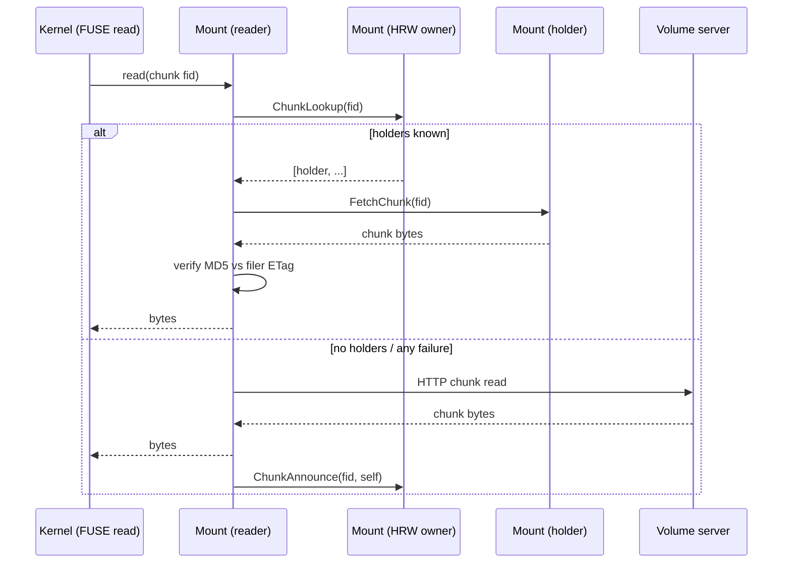

# P2P reading in weed mount

When a fleet of GPU hosts loads the same model file through `weed mount`, every client pulls bytes from the volume tier. Even with [`fs.distributeChunks`](./Distributing-AI-Model-Files-for-Multi-GPU-Loading.md) spreading the chunks evenly across every volume server, the volume tier's total NIC bandwidth caps how fast the read burst can complete. Peer chunk sharing lets mounts fetch chunks from each other instead, so after the first wave seeds a handful of mounts, subsequent reads fan out across the whole fleet.

This feature is opt-in via `-peer.enable=true` on `weed mount`. The filer side is always on — the registry's idle cost is negligible, so there is no flag to toggle it. When the mount flag is off — the default for `weed mount` — reads behave exactly as they do today.

The design is documented in [design-weed-mount-peer-chunk-sharing.md](https://github.com/seaweedfs/seaweedfs/blob/master/design-weed-mount-peer-chunk-sharing.md). This page is the operator-facing summary.

## How it works at a glance

```
    ┌──────────────────┐                ┌──────────────────┐
    │  Filer           │                │  Volume servers  │
    │  mount registry  │                │                  │
    └────────▲─────────┘                └────────▲─────────┘
             │ register / list                   │ read chunks
             │                                   │
    ┌────────┴─────────┐ read from peer ┌────────┴─────────┐
    │   weed mount     │ ◄────────────► │   weed mount     │
    └──────────────────┘                └──────────────────┘
```

### Chunk read sequence



* **Tier 1 — filer registry.** Each filer holds a tiny in-memory map of which mounts are alive. Mounts broadcast `MountRegister` to **every** configured filer, and merge every filer's `MountList` response by `peer_addr` (newest `last_seen_ns` wins). That way two mounts pointing at different filers still see each other even though no filer-to-filer sync exists.
* **Tier 2 — mount-hosted chunk directory.** The mount fleet itself shards a `fid → holders` directory via rendezvous hashing (HRW) on the registered mount list. Each owner mount only holds directory entries for fids it's HRW-assigned.
* **One gRPC port.** `ChunkAnnounce`, `ChunkLookup`, and the chunk-byte stream (`FetchChunk`) all go through a single mount-to-mount gRPC service. No separate HTTP peer-serve port.
* **Peer-serve path.** On the read path, each mount asks the HRW owner for holders, picks the best peer by locality (same rack > same DC > elsewhere, LRU tiebreak within each bucket), and server-streams the chunk bytes back. MD5/ETag verification on the full assembled buffer before returning to the kernel; any failure falls through cleanly to the volume tier.

## Enabling the feature

### On the filer

The filer accepts `MountRegister` / `MountList` RPCs unconditionally — the registry is a tiny in-memory map with negligible idle cost, so there is no flag to disable it. Nothing to configure on the filer side.

```bash
weed filer -master=master1:9333,master2:9333,master3:9333 \
           -ip=filer1 -port=8888
```

### On each mount

```bash
weed mount -filer=filer1:8888,filer2:8888 \
           -dir=/mnt/seaweedfs \
           -peer.enable=true \
           -peer.listen=:18080 \
           -peer.advertise=10.0.0.5:18080 \
           -peer.dataCenter=dc-east \
           -peer.rack=rack-a
```

The mount will:

1. Register with **every** configured filer's mount registry and heartbeat every 30 s.
2. Listen on `:18080` (gRPC) for `ChunkAnnounce` / `ChunkLookup` / `FetchChunk`.
3. On reads, try peer mounts before the volume tier. On any failure (owner unreachable, holder has since evicted, ETag mismatch, etc.) it falls through transparently to the volume path.

`-peer.advertise` is optional; when set, mounts receive that address from the filer's `MountList` instead of whatever the bind string would resolve to. It is required when `-peer.listen` uses a wildcard host (`":18080"`, `"0.0.0.0:18080"`, `"[::]:18080"`) and auto-detection can't find a reachable IP — in that case the mount will fail to start rather than advertise an unusable loopback address.

### Turning it off

Set `-peer.enable=false` (or omit the flag) on a rolling restart. The feature disables cleanly — the mount stops serving peers, stops registering with filers, and reads take the same path they did before.

## Flag reference

### `weed mount`

| Flag | Default | Meaning |
|------|---------|---------|
| `-peer.enable` | `false` | Opt-in master switch. |
| `-peer.listen` | `:18080` | bind address for the peer gRPC server (directory RPCs + chunk streaming). |
| `-peer.advertise` | *(auto-detect)* | externally-reachable `host:port` other mounts use to reach this one. Required with a wildcard `-peer.listen` when auto-detect fails. |
| `-peer.dataCenter` | `""` | data-center locality label advertised to peers. |
| `-peer.rack` | `""` | rack locality label (finer than DC). |

### `weed filer`

No flags. The mount registry is always on.

## When it helps

- Many mount clients reading the same large file in overlapping windows — LLM model loading across a GPU fleet is the canonical case.
- Fleets where inter-host bandwidth (10/25/100 GbE between GPU hosts) is abundant but the volume-tier aggregate NIC bandwidth is the bottleneck.
- Workloads with long-lived content access: chunks that stay cached on one mount remain servable to new arrivals for as long as they sit in that mount's on-disk cache.

## When it does not help

- Single-mount workloads: no peers to share with.
- Short-lived mount processes whose caches evict quickly: the TTL window for being discoverable is short.
- Writes: chunks are not shared peer-to-peer during writes; writes always go to volume servers. Peer sharing is read-only.

## Operational notes

### Port and firewall

Each mount binds `-peer.listen` for its gRPC server. That port must be reachable by every other mount in the same cluster (it carries directory RPCs and the chunk-byte stream). On Kubernetes, typically a `ClusterIP` service or `hostNetwork` pods; on bare metal, open the port on the inter-host network only.

### Authentication

The peer gRPC service reuses the same transport credentials the mount already uses for talking to the filer. When `security.toml` configures gRPC TLS, peer connections use it too — no separate credential.

### Integrity verification

Every fetched peer response is verified end-to-end by MD5 against `FileChunk.ETag` from the filer entry before its bytes are handed to the kernel. Mismatch → discard, fall through to the volume tier. This closes the trust gap opened by treating peer mounts as untrusted sources.

### Cache and TTL

Directory entries on owner mounts expire after 300 s (5 min) without a renewing `ChunkAnnounce`. Holder mounts re-announce fids they still hold roughly once per 270 s. The TTL is tuned for the desynchronized loader pattern where chunks stay cached for hours; bursty fleets that want faster eviction can shorten the interval in a later configuration flag.

No explicit retraction is sent on eviction — stale directory entries return a gRPC `NOT_FOUND` from the peer's `FetchChunk` call and the caller falls through. A single wasted RTT, no correctness impact.

### Locality-aware peer selection

When the owner returns multiple holders, the fetcher re-ranks them client-side:

1. Same rack (same `-peer.rack` AND same `-peer.dataCenter`) — best.
2. Same DC, different rack — next best.
3. Cross-DC or unknown labels — last.

Within each bucket the server's LRU order is preserved (freshest holder first). Unlabeled peers end up in bucket 3 — always give every mount at least `-peer.dataCenter` if you want meaningful locality ranking.

### Multi-filer deployments

The registrar broadcasts `MountRegister` to every filer listed in `-filer=` and merges every filer's `MountList` response. That's what lets two mounts pointing at different filers find each other even though the filer registries are in-memory per-filer with no cross-filer sync. An unreachable filer is tolerated; the mount keeps running as long as at least one filer succeeded on the last heartbeat.

## Disabling in an emergency

If peer sharing misbehaves in production, the kill switch is a rolling restart with `-peer.enable=false` on the mounts. Because the read path falls through to the volume tier on every failure mode, you should not observe read errors during the restart — just a gradual transfer of load back to the volume servers.

## Limitations

- **No write-path announce**: mounts don't advertise chunks they just uploaded. Same-host write-then-read still works (local cache), but cross-mount discovery of freshly-written chunks waits until another mount reads them first.
- **Chunk manifests**: supported transparently — the fetcher resolves manifests to leaf chunks before the HRW lookup, so large files using manifest indirection participate in peer sharing at the leaf level.
- **No metrics port on `weed mount`**: internal counters exist but the mount command does not currently expose a Prometheus endpoint. Observability lives in the glog stream (V(2) for warnings, V(4) for per-read success/failure).

## End-to-end CI

`test/fuse_p2p/` contains a FUSE-backed integration test that brings up a cluster of 3 mounts with `-peer.enable`, writes a file through one, and verifies a second mount can satisfy the read from the first mount's chunk cache. The `.github/workflows/fuse-p2p-integration.yml` workflow runs it on every pull request touching mount or filer peer code.

## See also

- [Distributing AI Model Files for Multi-GPU Loading](./Distributing-AI-Model-Files-for-Multi-GPU-Loading.md) — the placement side of the same problem; run `fs.distributeChunks` after upload before letting peer sharing do its thing.
- [FUSE Mount](./FUSE-Mount.md) — baseline mount configuration.
- [weed shell](./weed-shell.md) — operator console.
- Full design: `design-weed-mount-peer-chunk-sharing.md` in the SeaweedFS repo root.
