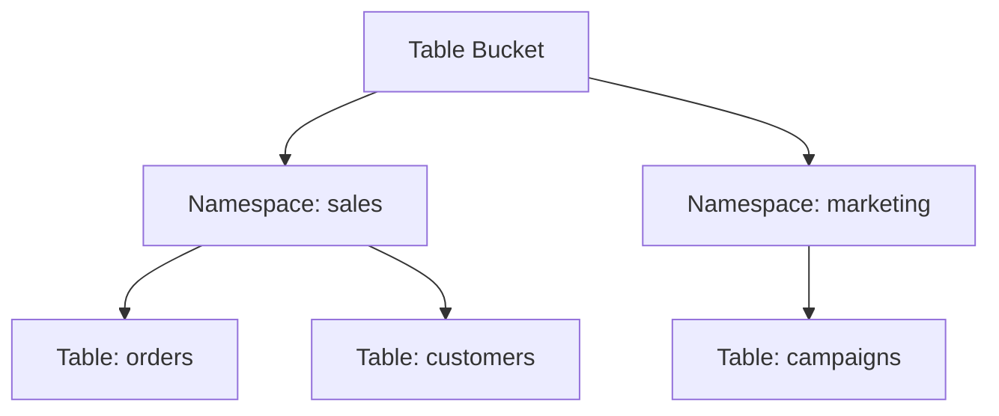
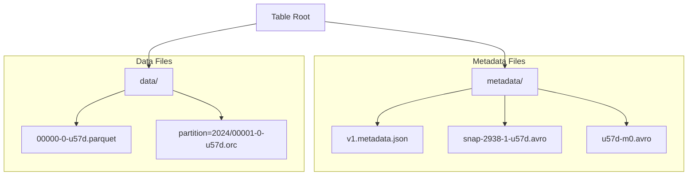
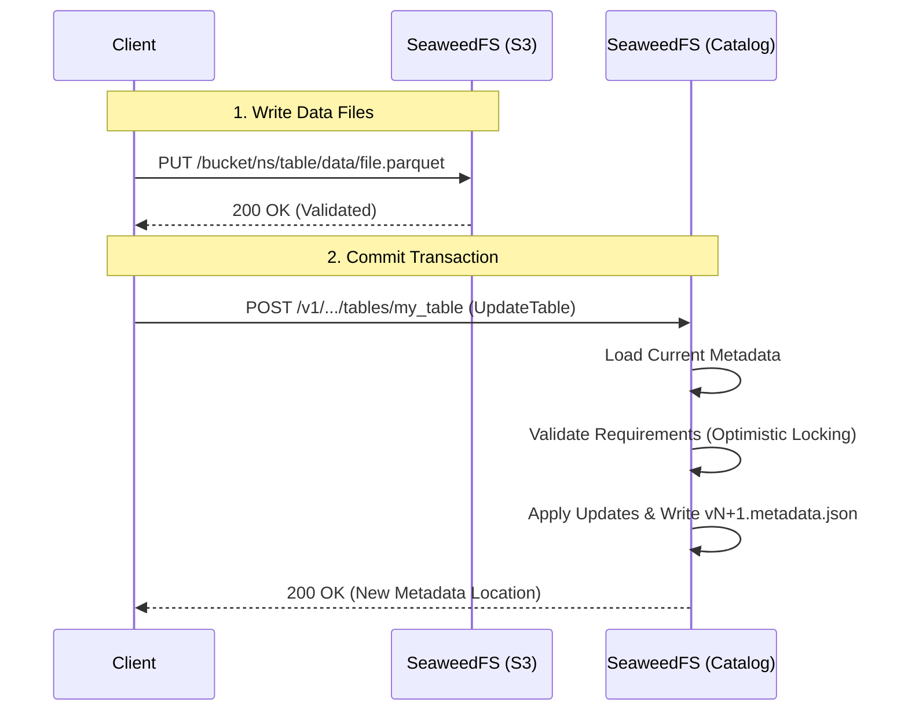
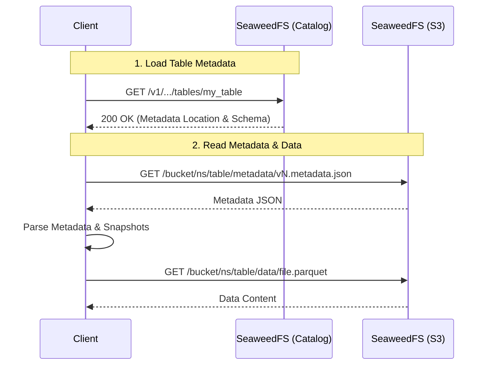

# S3 Tables

## Introduction

SeaweedFS supports **Amazon S3 Tables**, providing a dedicated interface for managing structured datasets. A table bucket holds one table format and declares which when it is created: **Apache Iceberg**, served by the [SeaweedFS Iceberg Catalog](./SeaweedFS-Iceberg-Catalog.md), or **Lance**, served by the [SeaweedFS Lance Catalog](./SeaweedFS-Lance-Catalog.md). Unlike standard S3 buckets that store unstructured objects, S3 Table Buckets are optimized for analytics workloads, offering a hierarchical structure of **Namespaces** and **Tables**.

This feature implements the **Iceberg REST Catalog API**, allowing direct integration with analytics engines like Apache Spark, Trino, Dremio, DuckDB, and RisingWave without needing an external catalog service.

## Why Table Buckets: Lakehouse in a Box

A typical Iceberg lakehouse stitches together three separate systems:

```
Spark / Trino   ->   Hive Metastore / AWS Glue   ->   S3 / MinIO
  (engine)            (catalog service)               (object store)
```

SeaweedFS collapses the catalog and object store into a single system:

```
Spark / Trino   ->   SeaweedFS  (Iceberg REST Catalog + S3 storage)
```

This removes an entire tier from the stack, with practical benefits:

- **Fewer moving parts** — no Hive Metastore, no Glue, no separate REST catalog service to deploy, secure, back up, and upgrade.
- **Simpler deployments** — one system serves both data and metadata, ideal for smaller teams and on-prem stacks. `weed mini` brings up an end-to-end lakehouse on a laptop in seconds.
- **Lower latency** — catalog calls and data reads hit the same cluster, with no extra network hop to an external metastore.
- **Local and air-gapped lakehouses** — full Iceberg support with no cloud-native dependency, running identically on a laptop, on-prem, or in cloud.
- **Unified IAM** — the same S3 bucket policies that protect your objects govern table, namespace, and catalog access (see [S3 Tables Security](./S3-Tables-Security.md)).

## Key Features

- **Dedicated Management**: Separate API namespace (`s3tables`) for managing table buckets, distinct from standard S3 bucket operations.
- **Hierarchical Structure**: Organizes data into a `Bucket -> Namespace -> Table` hierarchy, scalable for large data lakes.
- **Built-in Iceberg Support**: Native validation for Iceberg file layouts, ensuring data integrity.
- **Granular Security**: Apply IAM policies at the Bucket, Namespace, or Table level for fine-grained access control.
- **Performance Optimized**: Designed for high-throughput analytics workloads.

## Table Buckets vs. Normal Buckets

| Feature | S3 Table Bucket | Standard S3 Bucket |
| :--- | :--- | :--- |
| **Primary Use Case** | Structured Data Lake (Iceberg Tables) | General Object Storage (Files, Media, Backups) |
| **Data Structure** | Hierarchical: `Namespace` -> `Table` | Flat or Directory-like: `Prefix` / `Object` |
| **API** | S3 Tables API & Iceberg REST Catalog | Standard S3 API |
| **Validation** | **Strict Iceberg Layout** (enforced on write) | None (accepts any file content) |
| **Versioning** | Managed via Iceberg Snapshots | S3 Object Versioning |
| **Access Control** | Policies per Table/Namespace | Bucket Policies & ACLs |

## Architecture & File Layout

S3 Table Buckets enforce a strict directory structure to maintain compatibility with the Iceberg specification. This ensures that all data stored in a table bucket is valid and queryable.

### Logical Hierarchy



### Physical File Layout

Inside each **Table**, SeaweedFS enforces the following file layout. Writes that do not conform to this structure will be rejected.



### Valid File Paths

*   **Metadata Directory** (`metadata/`):
    *   `v*.metadata.json`: Table metadata files.
    *   `snap-*.avro`: Snapshot manifest lists.
    *   `*.avro`: Manifest files.
    *   `version-hint.text`: Pointer to the latest version.
    *   `*.stats`: Trino/Iceberg stats files.

*   **Data Directory** (`data/`):
    *   `*.parquet`, `*.orc`, `*.avro`: Data files containing the actual table rows.
    *   Supports partition subdirectories (e.g., `data/year=2024/month=01/file.parquet`).

## Workflows

The following diagrams illustrate how clients (like Spark, Trino, or Dremio) interact with SeaweedFS S3 Tables.

### Write (Commit) Workflow

When writing data to a table, the client first uploads the data files and then commits the transaction via the REST Catalog API.



### Read (Load) Workflow

To read a table, the client first asks the catalog for the current metadata location, then reads the metadata to discover which data files to scan.



## Documentation

- [S3 Table Bucket Commands](./S3-Table-Bucket-Commands.md) - Examples of how to create and manage table buckets.
- [SeaweedFS Iceberg Catalog](./SeaweedFS-Iceberg-Catalog.md) - Usage with Apache Spark, Trino, Dremio, and other engines.
- [Iceberg Table Maintenance](./Iceberg-Table-Maintenance.md) - Automated compaction, snapshot expiration, orphan removal, and manifest rewriting.
- [S3 Tables Security](./S3-Tables-Security.md) - IAM permissions and policy reference.
