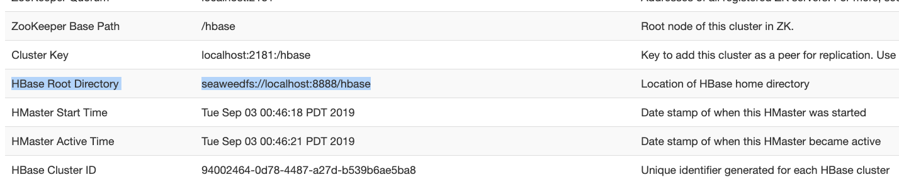

# Installation for HBase

Verified with Apache HBase 2.6.2 (standalone) on JDK 17, using `seaweedfs-hadoop3-client-4.38.jar`.
HBase talks to the SeaweedFS filer through the HCFS (`seaweedfs://`) scheme, so no S3 gateway is
needed. HBase 2.6.x ships Hadoop 2.10 jars; the hadoop3 client works against them since it only
adds the `seaweed.hdfs.*` classes and shades its own dependencies.

Three steps to run HBase on SeaweedFS:

1. Run HBase on JDK 8, 11, or 17. The `bin/hbase` launcher already adds the JDK 17 `--add-opens`
   flags, so setting `JAVA_HOME` is enough:

    ```
    export JAVA_HOME=/path/to/jdk-17
    ```

2. Copy `seaweedfs-hadoop3-client-4.38.jar` to `&#36;&#123;HBASE_HOME&#125;/lib`.

3. Set the following properties in `&#36;&#123;HBASE_HOME&#125;/conf/hbase-site.xml`. Point `hbase.rootdir` at
   your filer (default filer port is `8888`) and give `hbase.tmp.dir` a local path:

    ```
    <configuration>
      <property>
        <name>hbase.cluster.distributed</name>
        <value>false</value>
      </property>
      <property>
        <name>hbase.rootdir</name>
        <value>seaweedfs://localhost:8888/hbase</value>
      </property>
      <property>
        <name>hbase.tmp.dir</name>
        <value>/var/lib/hbase/tmp</value>
      </property>
      <property>
        <name>fs.seaweedfs.impl</name>
        <value>seaweed.hdfs.SeaweedFileSystem</value>
      </property>
      <property>
        <name>fs.AbstractFileSystem.seaweedfs.impl</name>
        <value>seaweed.hdfs.SeaweedAbstractFileSystem</value>
      </property>
      <property>
        <name>hbase.unsafe.stream.capability.enforce</name>
        <value>false</value>
      </property>
    </configuration>
    ```

    The SeaweedFS HCFS stream does not advertise `hflush`/`hsync`, so
    `hbase.unsafe.stream.capability.enforce=false` is required or HBase refuses to start.

Start HBase:

```
${HBASE_HOME}/bin/start-hbase.sh
```

Visit the HBase Web UI at `http://&lt;hostname&gt;:16010` to confirm HBase is running on SeaweedFS
(the "HBase Root Directory" reads `seaweedfs://...`).



Verify from `hbase shell`:

```
create 'swtest', 'cf'
put 'swtest', 'row1', 'cf:name', 'seaweed'
scan 'swtest'
```

The store files land under the filer, e.g. `weed shell` / `curl` on
`seaweedfs://localhost:8888/hbase/data/default/swtest/...`. Tables and rows survive a
`stop-hbase.sh` / `start-hbase.sh` restart.
